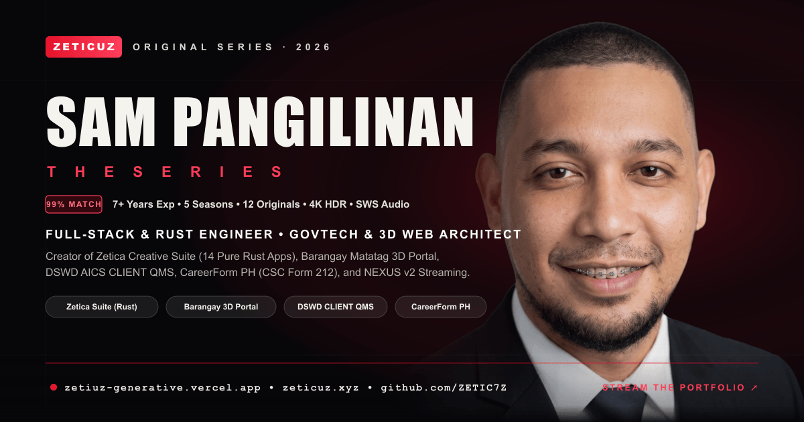

# 🎬 SAM PANGILINAN — THE SERIES (`ZETICUZ` Netflix-Style Portfolio)



[](https://zetiuz-generative.vercel.app/)
[](https://www.zeticuz.xyz/)
[](https://github.com/ZETIC7Z)
[](./LICENSE)

> **Every section is an episode. Every project is an Original. The entire portfolio streams like a flagship series.**

---

## 🌐 Deployed Links

- **🎬 Netflix-Style Series Portfolio (Primary):** [https://zetiuz-generative.vercel.app](https://zetiuz-generative.vercel.app)
- **🎬 Netflix-Style Series Portfolio (Mirror):** [https://zeticuz-generative.vercel.app](https://zeticuz-generative.vercel.app)
- **💼 Main Interactive Portfolio:** [https://www.zeticuz.xyz](https://www.zeticuz.xyz)
- **💻 GitHub Repository:** [https://github.com/ZETIC7Z/netflix-style-portfolio](https://github.com/ZETIC7Z/netflix-style-portfolio)

---

## 👤 About the Creator

**Sam Pangilinan** (`ZETICUZ` / `ZETIC7Z` / `TECHNOLOHIYA`) — **AI-First Full-Stack & Rust Engineer, GovTech Architect & 3D Web Systems Developer** with **7+ years** of production experience across enterprise operations, public-sector digital infrastructure, native Rust desktop applications, and high-availability streaming platforms.

- 🎓 **Education:** Associate in Computer Engineering Technician (2-Year Vocational College Diploma, 101 Units Earned, 2014–2016) — **Computer Technologies Institute (COMTECH) Inc., Zamboanga City**
- 🏛️ **Public Sector & Enterprise Experience:** DSWD (AICS Crisis Intervention Operations), Accenture Philippines, Legacy Group Real Estate (USA), The Winter Press (Melbourne), University of San Carlos, DENR, Zinex Cinematic, and Southwest Ticket & Tours.
- 🔗 **GitHub:** [github.com/ZETIC7Z](https://github.com/ZETIC7Z) (51+ repositories)
- 📺 **YouTube:** [@ZETICUZ](https://www.youtube.com/@ZETICUZ)
- 📘 **Facebook:** [facebook.com/sambabao.pangilinan](https://www.facebook.com/sambabao.pangilinan/)
- 📧 **Email:** [samxerz12@gmail.com](mailto:samxerz12@gmail.com) · [samxerz.zeticuz@gmail.com](mailto:samxerz.zeticuz@gmail.com)
- 📍 **Location:** Cebu City / Zamboanga City / Lamitan City, Philippines

---

## 🚀 Key System Features

### 1. 🎞️ Netflix-Style Episodic Architecture & Opening Sequence
- **Profile Selector & Cinematic Intro:** Interactive streaming profile gate (`Sam`, `Recruiter`, `Client`, `Guest`) and theatrical `ZETICUZ` opening sequence with GTA San Andreas `Diploma` Old English SVG emblem branding.
- **Continue Watching Rail:** Tracks your viewing progress across sections (`Originals`, `Story`, `Journey`, `Skills`, `Top Moments`, `Resume`) in real time using `IntersectionObserver`.

### 2. 📺 5-Season Auto-Advancing Career Journey (`Seasons.tsx`)
- **Chronological 5-Season Player (`S01` → `S05` → `S01`):** Automatically starts at **Season 1** and advances smoothly every **12 seconds** through **Season 5** before looping back to Season 1, with pause-on-hover and manual season/episode selection.
- **Dedicated Institutional Cards:** Every organization and government agency has its own dedicated episode card and verified institutional emblem (`COMTECH Inc.`, `Zinex`, `DENR`, `Southwest Ticket & Tours`, `BPAT`, `DICT`, `Legacy Group Real Estate USA`, `University of San Carlos`, `DSWD`, `Accenture Philippines`, `Zetica Creative Suite`, and `ZETICUZ Studio`).

### 3. 🎥 12 Flagship "Originals" with 1080p HD Video Trailers (`Originals.tsx` & `ProjectModal.tsx`)
- **Strictly Sorted Newest-First by GitHub Creation Date:** Displays all **12 flagship production projects** in a sticky horizontal showcase rail and interactive filterable catalog.
- **Silent 1080p HD Promos (`public/trailers/*.mp4`):** Clicking any project opens a full-screen streaming modal with a custom-edited 1080p 60fps video trailer (silent by design so it never clashes with the background music player), Theater Mode toggle, architectural breakdown, impact metrics, live launch link, and GitHub source link.

### 4. 🎵 Built-In SWS YouTube Music Player (`SWSMusicPlayer.tsx` & `AudioPlayerContext.tsx`)
- **Ported 1:1 from SWS Skeptrons (`sws-website`):** Full-featured YouTube IFrame API music player styled in **ZETICUZ Crimson & Obsidian** (`#e5132b` / `#ff3d5a` / `#0b0b12`).
- **Starts at `0:00` on Fresh Browsers & Auto-Resumes in Same Browser:** Opens at **`0:00`** on *"OPM Trending Playlist 2026 — Must Listen Filipino Songs Mix"* (`https://www.youtube.com/watch?v=iNsO2CbCV0Y`) for any new browser visitor, and automatically syncs & resumes your exact playback timestamp, active track, and custom playlist when you close and reopen the site in the same browser.
- **Live YouTube Data API v3 Search, Queue & Reordering:** Search any song on YouTube directly inside the player, play immediately or click `+` to add to your queue, rearrange tracks in `Playing Next` via **Drag-and-Drop (`⋮⋮`)** or **Move Up (`↑`) / Move Down (`↓`)** controls, remove tracks, adjust volume (`0–100%`), scrub timestamps, minimize, or expand to fullscreen.
- **Dual Synchronized Controls:** Accessible both as a full horizontal deck on the Home Page and as a live mini-pill + popover player in the top Navbar.

### 5. 🎮 Authentic GTA Menu Sound Engine (`src/hooks/sound.tsx`)
- **Zero Noisy Synthesizers:** Uses authentic Rockstar GTA menu `.wav` audio samples preloaded into Web Audio API `AudioBuffer` memory:
  - **Hover / Point (`pointing-cursor.wav`):** Plays crisp tactile feedback when pointing at any button, tab, link, or project card.
  - **Click / Select (`gta-menu.wav`):** Plays authentic GTA menu confirmation when clicking any interactive control.
  - Instant global mute/unmute via the top Navbar **`SFX ON` / `SFX OFF`** toggle.

### 6. 🧠 Bespoke SVG Skills Universe (`Skills.tsx` & `SkillIcons.tsx`)
- **58+ Custom Multi-Color Vector Brand Icons:** Every technology across all 6 engineering domains (`Frontend & 3D WebGL`, `Backend, Streaming & APIs`, `Databases & Cloud Auth`, `AI & Agentic Engineering`, `DevOps, GIS & Quality`, and `GovTech & Enterprise Ops`) renders its own bespoke SVG icon—including `Rust & WebGPU`, `React`, `TypeScript`, `Three.js`, `REA (Reverse Engineering)`, `Claude Code & Antigravity`, `Chrome DevTools & Playwright MCP`, `Firecrawl & Context7 MCP`, `CS Form 212 PDF Engine`, and `3D GIS / KML Engine`.

### 7. 🏆 Paginated Top Moments & Official Credentials Viewer (`Achievements.tsx` & `ResumeModal.tsx`)
- **Interactive Prev / Next Carousel:** Browse 16 separated project and career milestones with smooth pagination, dot indicators, and keyboard arrow navigation.
- **Embedded PDF Viewers:** View or download Sam Pangilinan's official **2-Page Resume (`Sam_Pangilinan_Resume.pdf`)** and **13-Page Scanned Certificates (`Sam_Pangilinan_Certificates.pdf`)** directly inside the site.

### 8. 📬 Direct AJAX Contact Form & Social Hub (`FinalCTA.tsx`)
- **Zero-Reload Inquiry Dispatch:** Sends messages directly via `FormSubmit.co` AJAX API with instant delivery confirmation, paired with quick-fill inquiry templates and social links (`GitHub`, `YouTube`, `Facebook`, `Email`, `Phone`).

---

## 🛠️ Featured "Originals" Catalog (12 Production Projects — Sorted Newest First)

| # | Project Title | Created | Category | Live URL | GitHub Repo | Core Tech Stack |
|---|---|---|---|---|---|---|
| **01** | **Zetica Creative Suite & Hub (14 Native Rust Apps)** | Nov 2026 | Native Rust Desktop & 3D Web | [zetica.vercel.app](https://zetica.vercel.app/) | [ZETIC7Z/artcraft](https://github.com/ZETIC7Z/artcraft) | Rust, egui, WGPU, Three.js, WebGL2, GLSL, Lenis, WiX v5 MSI |
| **02** | **Barangay Matatag — Smart 3D E-Governance Portal** | Oct 2026 | 3D GovTech & GIS Platform | [smart-brgy.vercel.app](https://smart-brgy.vercel.app/) | [ZETIC7Z/Barangay-Online-E-Governance-Portal](https://github.com/ZETIC7Z/Barangay-Online-E-Governance-Portal) | React 18, TypeScript, Google Maps 3D, Express, Socket.IO, MongoDB |
| **03** | **CLIENT QMS — DSWD AICS Queuing & Verification** | Oct 2026 | GovTech Operations | [client-qms.vercel.app](https://client-qms.vercel.app/) | [ZETIC7Z/CLIENT-QMS](https://github.com/ZETIC7Z/CLIENT-QMS) | React 19, TypeScript, Tailwind v4, Express, LowDB, QR Scanner, Web Audio |
| **04** | **CareerForm PH — CSC Form 212 & Jobs Portal** | Sep 2026 | GovTech & AI Document Suite | [careerform-ph.vercel.app](https://careerform-ph.vercel.app/) | [ZETIC7Z/CareerForm](https://github.com/ZETIC7Z/CareerForm) | Next.js 15, React 19, TypeScript, pdf-lib, Three.js, MongoDB |
| **05** | **LifeCoachDoc v2 — Clinical Psychology Portfolio** | Sep 2026 | 3D WebGL & Healthcare UI | [lifecoachdoc2.vercel.app](https://lifecoachdoc2.vercel.app/) | [ZETIC7Z/lifecoachdoc2](https://github.com/ZETIC7Z/lifecoachdoc2) | Next.js 15, React 19, Three.js, Radix UI, Tailwind CSS, Framer Motion |
| **06** | **LifeCoachDoc v1 — Dark-Luxury Author Site** | Sep 2026 | 3D Book & Multi-Theme Web | [lifecoachdoc.vercel.app](https://lifecoachdoc.vercel.app/) | [ZETIC7Z/Frances-Gaik-WEBSITE](https://github.com/ZETIC7Z/Frances-Gaik-WEBSITE) | Next.js 15, React 19, Three.js, Framer Motion, 13-Palette Engine |
| **07** | **NEXUS v2 — Next-Gen Streaming & Cuts Platform** | Aug 2026 | Flagship Streaming PWA | [nexusph.xyz](https://www.nexusph.xyz/) | [ZETIC7Z/nexus.20](https://github.com/ZETIC7Z/nexus.20) | React 18, TypeScript, Vite, Zustand, HLS.js, Node.js, AES-GCM |
| **08** | **Dr. Nwanganga Shields — Author & Memoir Platform** | Jul 2026 | Full-Stack Editorial & Analytics | [nwanganga-shields.vercel.app](https://nwanganga-shields.vercel.app/) | [ZETIC7Z/autobiography-test](https://github.com/ZETIC7Z/autobiography-test) | TanStack Start, React, TypeScript, Supabase, Framer Motion, Recharts |
| **09** | **SWS Skeptrons — Official Chapter Platform** | May 2026 | Full-Stack Community Portal | [sws-skeptrons.vercel.app](https://sws-skeptrons.vercel.app/) | [ZETIC7Z/sws-website](https://github.com/ZETIC7Z/sws-website) | React, TypeScript, Tailwind CSS, Framer Motion, Express, MongoDB |
| **10** | **Dekaron Stampede — MMORPG Gaming Portal** | Mar 2026 | Interactive Gaming Hub | [dekaron-stampede.vercel.app](https://dekaron-stampede.vercel.app/) | [ZETIC7Z/dekaron-stampede](https://github.com/ZETIC7Z/dekaron-stampede) | React, TypeScript, Tailwind CSS, Framer Motion, Vite, Lucide React |
| **11** | **ZETFLIX TV — Movie & Series Discovery Hub** | Feb 2026 | Entertainment & Streaming UI | [zetflix-tv.vercel.app](https://zetflix-tv.vercel.app/) | [ZETIC7Z/ZETFLIX-OFFICIAL](https://github.com/ZETIC7Z/ZETFLIX-OFFICIAL) | React, Node.js, MongoDB, Material-UI, TMDB API, Supabase, Redux |
| **12** | **NEXUS Streaming (v1) — High-Availability PWA** | Jan 2026 | Streaming PWA | [zeticuz.online](https://www.zeticuz.online/) | [ZETIC7Z/NEXUS](https://github.com/ZETIC7Z/NEXUS) | React, TypeScript, Tailwind CSS, Zustand, HLS.js, PWA, Vite |

---

## 🧰 Complete Technology Stack

| Layer | Technologies Used |
|---|---|
| **Core Framework** | React 18.3, TypeScript 5.8, Vite 6.3 |
| **Styling & Design System** | Tailwind CSS v4 (`@tailwindcss/vite`), Custom ZETICUZ Crimson & Obsidian Tokens (`#07070a`, `#e5132b`, `#ff3d5a`), Bebas Neue + Instrument Serif + Inter Typography |
| **Motion & Smooth Scroll** | Framer Motion 11.18, Lenis 1.1.20 (`60fps` inertial scroll), `IntersectionObserver` reveal choreography |
| **Audio & Music Systems** | YouTube IFrame Player API, YouTube Data API v3 Search, Web Audio API `AudioBuffer` Engine (Rockstar GTA Menu `.wav` SFX) |
| **Media & Asset Pipeline** | Sharp (`WebP` / `PNG` / `JPEG` optimization), FFmpeg (`H.264` 1080p 60fps silent `.mp4` trailers with `+faststart`), Playwright Automated Capture |
| **SEO & Social Metadata** | OpenGraph (`1200x630` `og-image.png`), Twitter `summary_large_image` Cards, JSON-LD `Schema.org/Person` Structured Data, `robots.txt`, `sitemap.xml` |
| **Deployment & Hosting** | Vercel Production CDN with immutable asset caching (`vercel.json`) |

---

## 📁 Project Structure

```text
netflix-style-portfolio/
├── public/
│   ├── assets/                  # Optimized WebP portraits, resume & certificates PDFs, org logos
│   ├── cards/                   # Custom 16:9 visual cards for Story, Journey, Skills & Top Moments
│   ├── projects/                # 16:9 landscape & 2:3 poster artwork for all 12 Originals
│   ├── sfx/                     # Authentic GTA menu hover (pointing-cursor.wav) & click (gta-menu.wav) SFX
│   ├── trailers/                # 12 silent 1080p 60fps MP4 project trailers
│   ├── favicon.png              # ZETICUZ emblem favicon
│   ├── og-image.png             # 1200x630 OpenGraph / Twitter social share preview card
│   ├── robots.txt               # Search crawler directives
│   ├── sitemap.xml              # XML sitemap for SEO indexing
│   └── zeticuz-logo.svg         # Official ZETICUZ 3D emblem + GTA Old English wordmark SVG
├── scripts/
│   ├── build-images.mjs         # Portrait responsive WebP builder
│   ├── build-og-image.mjs       # 1200x630 OpenGraph social card generator
│   ├── build-project-images.mjs # Project poster & backdrop generator
│   └── record-trailers.mjs      # Playwright + FFmpeg automated trailer pipeline
├── src/
│   ├── components/
│   │   ├── Navbar.tsx           # Top bar with ZETICUZ logo, nav links, live Music Pill & SFX toggle
│   │   ├── Hero.tsx             # Episode 01 Hero stage with 3D tilt portrait & quick actions
│   │   ├── SWSMusicPlayer.tsx   # Full SWS YouTube Music Player with search, queue & volume controls
│   │   ├── ContinueWatching.tsx # Real-time section progress tracker rail
│   │   ├── About.tsx            # Story & Origin cards with verified Comtech Institute education
│   │   ├── Seasons.tsx          # 5-Season auto-advancing career journey player (12s per season)
│   │   ├── Originals.tsx        # Sticky horizontal showcase + filterable catalog of 12 Originals
│   │   ├── ProjectModal.tsx     # Full-screen 1080p trailer player & architectural breakdown modal
│   │   ├── TopPicks.tsx         # Curated Top Picks rail (GovTech, Streaming, Rust Desktop)
│   │   ├── Skills.tsx           # 5-domain Skills Universe with 58+ custom SVG icons
│   │   ├── SkillIcons.tsx       # Bespoke multi-color SVG icon library
│   │   ├── Achievements.tsx     # Paginated Top Moments carousel & Verified Certifications grid
│   │   ├── ResumeViewer.tsx     # Embedded Resume & 13-page Certificates section
│   │   ├── ResumeModal.tsx      # Full-screen PDF viewer modal
│   │   └── FinalCTA.tsx         # Direct FormSubmit AJAX contact form, social hub & ZETICUZ footer
│   ├── context/
│   │   └── AudioPlayerContext.tsx # Global YouTube IFrame API state & playlist queue provider
│   ├── data/
│   │   └── portfolio.ts         # Single source of truth for all projects, seasons, skills & bio
│   ├── hooks/
│   │   ├── sound.tsx            # GTA menu .wav Web Audio API hook
│   │   └── smoothScroll.tsx     # Lenis smooth scroll & active section observer
│   ├── App.tsx                  # Root application layout & modal orchestration
│   ├── main.tsx                 # React 18 DOM entry point
│   └── index.css                # Tailwind v4 theme tokens & custom utility styles
├── index.html                   # SEO, OpenGraph, Twitter Card & JSON-LD structured metadata
├── vercel.json                  # SPA rewrite rules & immutable CDN cache headers
├── LICENSE                      # MIT License
├── package.json                 # Project dependencies & build scripts
└── README.md                    # Project documentation
```

---

## ⚡ Getting Started Locally

### Prerequisites
- **Node.js 18+** and **npm 9+**

### 1. Clone the Repository
```bash
git clone https://github.com/ZETIC7Z/netflix-style-portfolio.git
cd netflix-style-portfolio
```

### 2. Install Dependencies
```bash
npm install
```

### 3. Start Local Development Server
```bash
npm run dev -- --port 5175 --host
```
Open **[http://localhost:5175](http://localhost:5175)** in your browser.

### 4. Build for Production
```bash
npm run build
npm run preview
```

---

## 🌐 Deploying to Vercel

This project is pre-configured with [`vercel.json`](./vercel.json) for zero-configuration deployment on Vercel:

```bash
npx vercel link
npx vercel deploy --prod
```

---

## 📜 License

This project is licensed under the **MIT License** — see the [LICENSE](./LICENSE) file for full details.

Copyright © 2026 **Sam Pangilinan (`ZETICUZ` / `ZETIC7Z` / `TECHNOLOHIYA`)**.

---

<p align="center">
  <strong>SITE DEVELOPED BY: Sam Pangilinan · © 2026</strong><br/>
  <a href="https://www.zeticuz.xyz/">Explore Developer Portfolio & Projects ↗</a> ·
  <a href="https://zetiuz-generative.vercel.app/">Watch The Series ↗</a> ·
  <a href="https://github.com/ZETIC7Z">GitHub (@ZETIC7Z) ↗</a>
</p>
